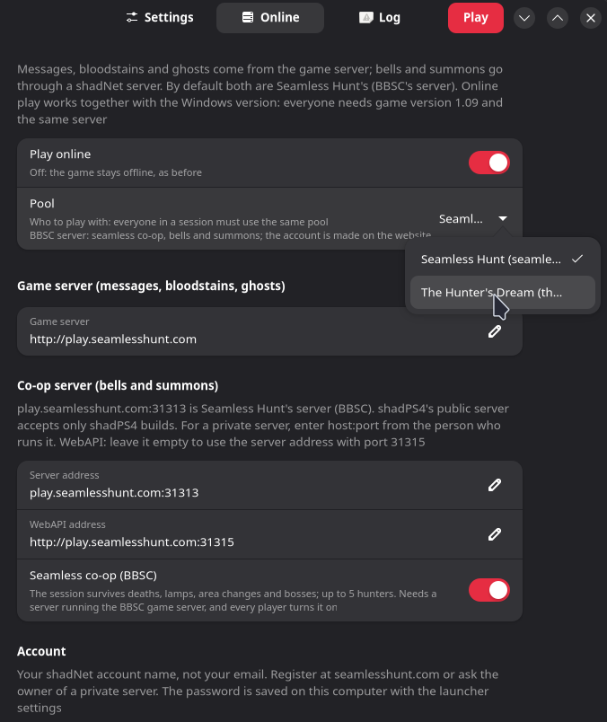
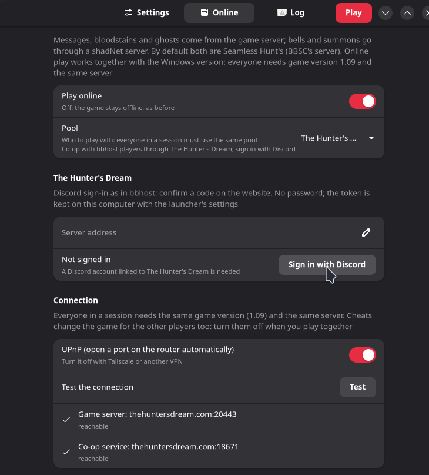
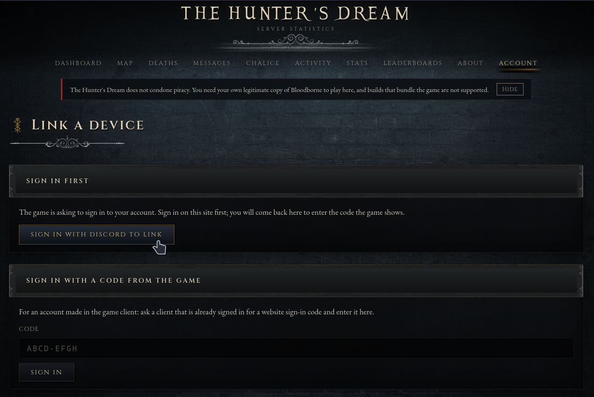
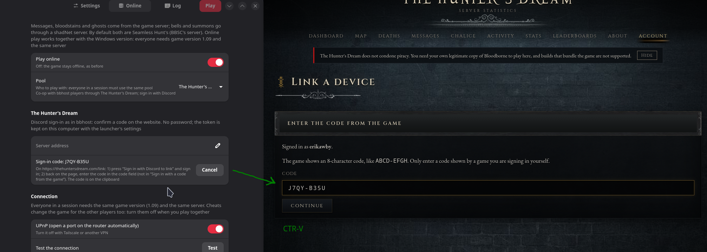
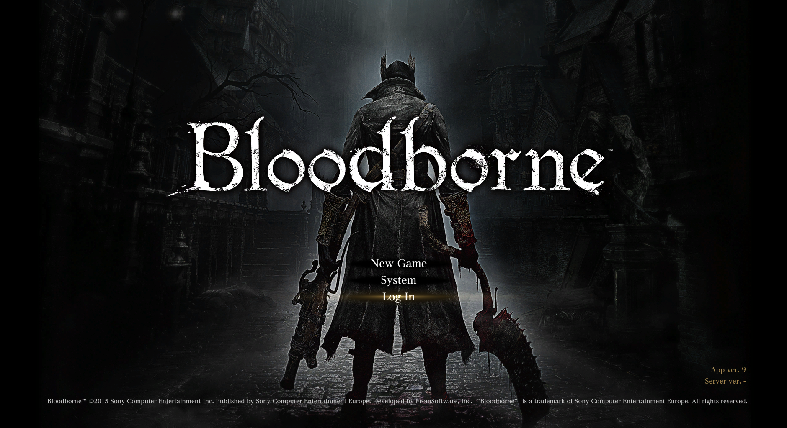

#### Welcome Hunter, This guide will show you how to log into The Hunter's Dream.
First you must have a BBport launcher and game instance running. You should be able to make a character and immediately die. After this check with your launcher again. 
##### Step 1)
In the online tab of your launcher change to pool to The Hunter's Dream 

##### Step 2)
Click the Sign in Button

##### Step 3)
read the instructions carefully.
##### Step 4)
~~Ignore step 3~~
Navigate to the auto-opened tab in your browser and click the Login with Discord and link your discord to The hunter's dream. Click the Authorize request.
If the browser was not opened simply go to https://thehuntersdream.com/link

##### Step 5)
Then put the Code into the Code slot. No need to worry it is already copied to clipboard. Then press continue. Press accept to all the buttons. 

##### Step 6)
Press play and once in-game login. If this fails check: The Hunter's dream website if the servers are online, your vpn, and/or firewall. 

